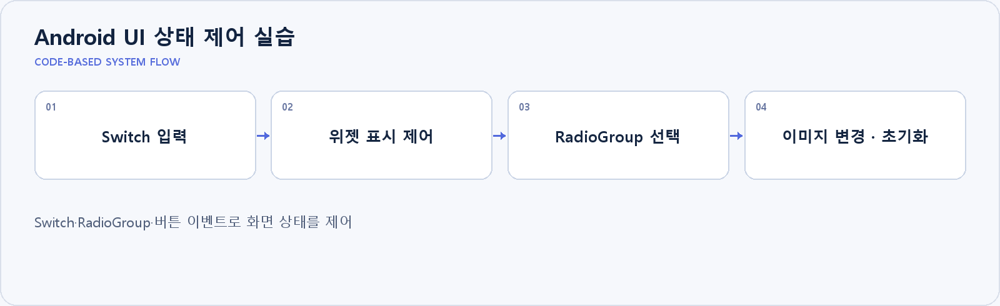

# Android UI 상태 제어 실습

**Switch·RadioGroup·버튼 이벤트로 화면 상태를 제어**

## 프로젝트와 담당 범위

교내 Kotlin·Android 기초 실습입니다. Switch 상태에 따라 위젯 표시 여부를 바꾸고, RadioGroup 선택값으로 이미지를 변경합니다. 초기화 버튼은 선택 상태를 지우고 종료 버튼은 Activity를 닫습니다. AI 또는 상용 앱 개발 경험으로 분류하지 않습니다.

## 구현 근거

[MainActivity](app/src/main/java/com/example/homework1/MainActivity.kt)

기존 설치·구현 문서는 [README_DETAILS.md](README_DETAILS.md)에 보존했습니다.
